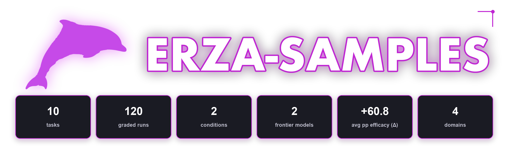
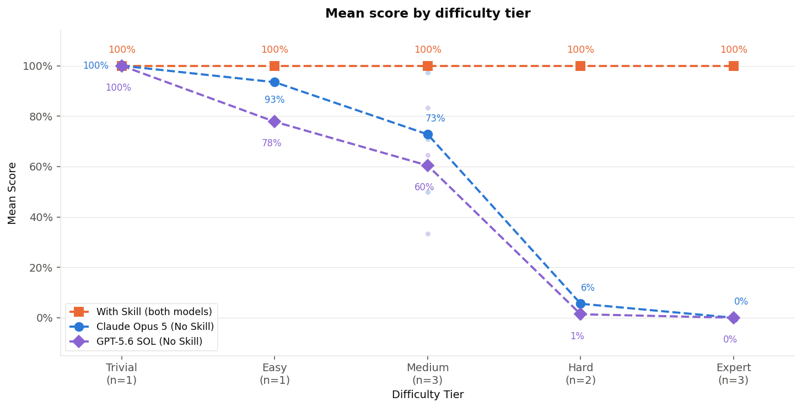
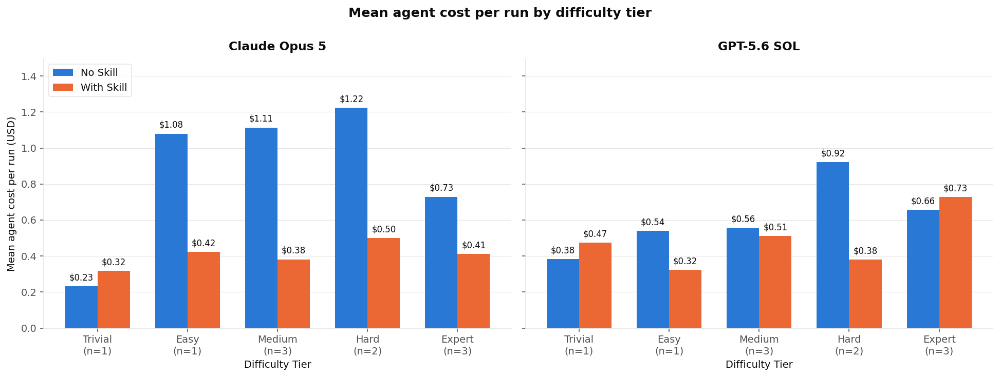
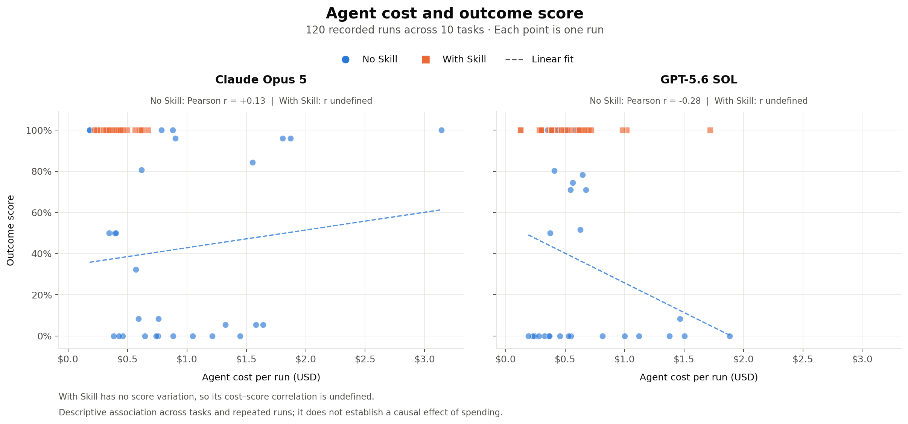
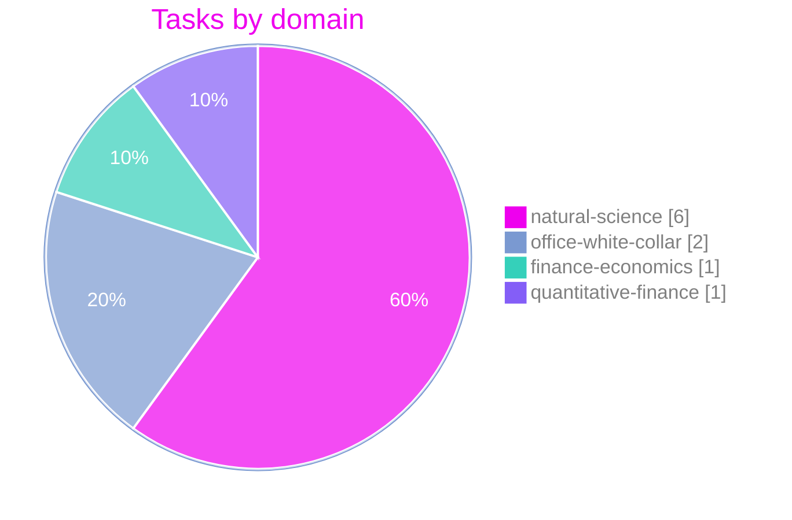
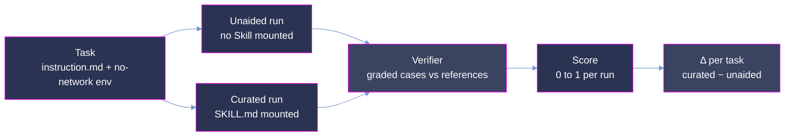

<p align="center">
  
</p>

<p align="center">
  <strong>How much does a curated Skill change what a frontier agent can do? Measured in paired runs.</strong>
</p>

<p align="center">
  <a href="#summary"></a>
  <a href="#scoring-methodology"></a>
  <a href="#scoring-methodology"></a>
  <a href="#difficulty-tiers"></a>
</p>

<p align="center"><sub>
  <a href="#summary">Summary</a> · <a href="#repository-layout">Layout</a> · <a href="#difficulty-tiers">Tiers</a> · <a href="#results-skill-efficacy-vs-unaided-difficulty">Results</a> · <a href="#analysis">Analysis</a> · <a href="#coverage">Coverage</a> · <a href="#dataset-structure">Dataset</a> · <a href="#trajectory-structure">Trajectories</a> · <a href="#scoring-methodology">Scoring</a> · <a href="#reproduction">Reproduction</a> · <a href="#verification-and-quality-assurance">Verification</a>
</sub></p>

# Erza: 10-Task Agent-Skills Efficacy Sample

**Erza asks a narrower question than a capability benchmark.** Given one task, one container, one prompt
and one verifier, how much does the agent's score change when a curated domain Skill is placed on its
filesystem? Each task is therefore run twice. The unaided run has no Skill; the curated run has the
task's Skill mounted and nothing else different. The headline quantity is Skill efficacy, written Δ: the
curated score minus the unaided score, computed per task and then averaged.

This repository is a **10-task** sample from Erza. Each task is a self-contained, containerized
domain-procedure problem. It ships with the complete agent trajectories of two frontier models,
Claude Opus 5 and GPT-5.6 SOL, under both conditions at 3 runs each: 120 graded runs, each scored by
the task's own verifier.

The tasks fall into five difficulty tiers (Trivial, Easy, Medium, Hard, Expert), calibrated from the
unaided scores observed on this sample. They cover 10 subcategories across 4 domains.

Unaided, the models average 100% on the Trivial tier and 0% on Expert. With the Skill they average 100%
in all five tiers. Δ therefore runs from 0 points on Trivial to 100 points on Expert. The tier
definitions are in [Difficulty tiers](#difficulty-tiers).



> **This is a quality-controlled sample of the full Erza corpus,** provided for evaluation. The dataset
> format, the trajectory format and the scoring are the same as in the production benchmark.

## Summary

| Property            | Value                                                                                        |
| :------------------ | :------------------------------------------------------------------------------------------- |
| Tasks               | **10** (Trivial 1 / Easy 1 / Medium 3 / Hard 2 / Expert 3)                                   |
| Difficulty tiers    | 5, by **observed unaided difficulty**                                                        |
| Models evaluated    | Claude Opus 5, GPT-5.6 SOL                                                                   |
| Conditions          | 2 per task: unaided (`no-skill`) and curated Skill mounted (`with-skill`)                    |
| Runs & grid         | 3 per model per condition = 12 per task, 120 total; full 2 × 2 × 3, no gaps                   |
| Score               | outcome score in [0, 1] per run in `result.json`; graded cases passed / graded cases on 8 tasks, all-or-nothing on 2 |
| Domains             | 4 (natural-science, office-white-collar, finance-economics, quantitative-finance)             |
| Subcategories       | 10, one per task                                                                             |

**Skill efficacy on this sample** (see [Scoring methodology](#scoring-methodology) for how A, B and Δ
are defined):

| Metric                              | Claude Opus 5 | GPT-5.6 SOL |    Pooled |
| :---------------------------------- | ------------: | ----------: | --------: |
| Unaided mean score A                |         42.3% |       36.2% |     39.2% |
| Curated mean score B                |        100.0% |      100.0% |    100.0% |
| **Skill efficacy Δ = B − A**        |  **+57.7 pp** | **+63.8 pp** | **+60.8 pp** |
| Unaided runs solved (score = 1.0)   |        6 / 30 |      6 / 30 |   12 / 60 |
| Curated runs solved (score = 1.0)   |       30 / 30 |     30 / 30 |   60 / 60 |

## Repository layout

```
erza-samples/
├── README.md                          # this document
├── images/                            # figures and their generators
│   ├── hero.png
│   ├── score_by_tier_pooled.png       # with score_by_tier_pooled.py
│   ├── cost_by_tier.png               # with cost_by_tier.py
│   └── cost_vs_score.png              # with cost_vs_score.py
└── <task-id>/                         # one directory per task (10): the task bundle and its 12 runs
    ├── task.toml · instruction.md · TRUTH.md · environment/ · oracle/ · tests/
    └── trajectories/<model>/<condition>/run_N/   # model ∈ {claude-opus-5, gpt-5.6-sol}; condition ∈ {no-skill, with-skill}
```

A task directory holds the task definition and its runs together. Under `trajectories/` there is one
`<model>/` directory per model, one `<condition>/` directory under each, and three `run_N/` directories
under those. That is 12 runs per task; no cell of the 2 × 2 × 3 grid is empty on any of the 10 tasks.

## Difficulty tiers

A task's tier comes from its unaided mean score A, the mean over its six `no-skill` runs (three per
model), binned at fixed cut-points. Expert is A = 0 exactly. Hard is 0 < A ≤ 0.35. Medium is
0.35 < A ≤ 0.7. Easy is 0.7 < A < 1. Trivial is A = 1 exactly. On this sample the Trivial task was
solved by all six unaided runs and the Expert tasks by none.

The stratification is computed from the runs shipped here, so it describes the difficulty the models
met, not a property assigned in advance. All ten `task.toml` files declare `difficulty = "hard"`, while
the observed A ranges from 0.000 to 1.000; the declared field is not used for the axis. In the figure
above, each model has its own unaided curve. The curated arm is drawn once because both models score
1.000 on all of their curated runs.

| Tier        |   n | Tasks                                  | mean A | mean Δ |
| :---------- | --: | :------------------------------------- | -----: | -----: |
| **Trivial** |   1 | `ebdbad6e`                             |  1.000 | +0.000 |
| **Easy**    |   1 | `c7faca71`                             |  0.856 | +0.144 |
| **Medium**  |   3 | `20840ce0`, `446e76fe`, `aec90ff1`     |  0.666 | +0.334 |
| **Hard**    |   2 | `d427488f`, `e9474235`                 |  0.035 | +0.965 |
| **Expert**  |   3 | `51853948`, `6f76812f`, `c59f8b2a`     |  0.000 | +1.000 |

Six unaided runs per task is a small base for a tier placement. `d427488f` (A = 0.028) and
`e9474235` (A = 0.042) are within 0.05 of the Hard/Expert boundary, and `aec90ff1` (A = 0.667) is
0.033 below the Medium/Easy boundary. One run moving in either direction would move any of them.

## Results: skill efficacy vs unaided difficulty

The tier axis is built from the unaided score, so the unaided curves in the figure above fall across
the tiers by construction. What the figure measures is the curated curve and the gap below it. The
curated arm scores 1.000 in all five tiers, so Δ is whatever the unaided arm left on the table: +0 pp
on Trivial, whose single task both arms solve, up to +100 pp on Expert.

All per-task figures can be recomputed from the shipped files. Per-run scores are in each run's
`result.json` (`scores.score`) and again in `verifier/score.md`; the graded case count is in the
`outcome` block of `verifier/process.json`.

**Per task** (unaided mean A per model over 3 runs; every curated run scores 1.000):

| Task       | Subject                              | Domain / subcategory                                  | Graded cases | A Claude Opus 5 | A GPT-5.6 SOL | A pooled | Tier    |
| :--------- | :----------------------------------- | :---------------------------------------------------- | -----------: | --------------: | ------------: | -------: | :------ |
| `ebdbad6e` | Energy sector heat content           | finance-economics / energy-statistics                 |            5 |           1.000 |         1.000 |    1.000 | Trivial |
| `c7faca71` | Flight duty period legality          | office-white-collar / aviation-regulatory-compliance  |           51 |           0.935 |         0.778 |    0.856 | Easy    |
| `20840ce0` | Information return record emission   | office-white-collar / tax-information-reporting       |           31 |           0.710 |         0.645 |    0.677 | Medium  |
| `aec90ff1` | Day-count fractions and accrued interest | quantitative-finance / fixed-income               |            4 |           0.500 |         0.833 |    0.667 | Medium  |
| `446e76fe` | Local magnitude from a seismogram    | natural-science / seismology                          |          1 † |           0.973 |         0.333 |    0.653 | Medium  |
| `e9474235` | Tidal harmonic prediction            | natural-science / oceanography                        |           12 |           0.056 |         0.028 |    0.042 | Hard    |
| `d427488f` | Proficiency-testing robust consensus | natural-science / metrology                           |          2 † |           0.056 |         0.000 |    0.028 | Hard    |
| `51853948` | Gauge rating block discharge         | natural-science / hydrology                           |           12 |           0.000 |         0.000 |    0.000 | Expert  |
| `6f76812f` | Ionosphere arc VTEC calibration      | natural-science / ionospheric-physics                 |           12 |           0.000 |         0.000 |    0.000 | Expert  |
| `c59f8b2a` | Antenna phase-centre correction      | natural-science / geodesy                             |           12 |           0.000 |         0.000 |    0.000 | Expert  |

† The count the shipped grader defines, recorded by every GPT-5.6 SOL run. Five of the six Claude Opus 5
runs of `446e76fe` record 25 graded cases, and all six Claude Opus 5 runs of `d427488f` record 18; see
Limitations.

**Process scoring by task and model** (A = unaided, B = curated Skill mounted):

Each cell is the mean of three per-run channel scores for the named model and condition. Deterministic
scores use the pytest verdicts in `verifier/process.json`; judged scores use its `human.criteria`
verdicts, whose rationales also appear in `verifier/verdicts.jsonl`. Both channels have complete
verdict coverage across all 120 runs.

Within each run, the channel score is `sum(abs(weight) * success) / sum(abs(weight))`, using the
weights in `tests/rubrics.json`. Success means a positive criterion was satisfied or a guardrail
was not violated; weight-0 criteria are report-only and contribute nothing. These are separate
channel means, excluding outcome cases and grader self-checks, with no composite gate cap applied.
Each model's mean row gives the ten tasks equal weight.

**Claude Opus 5**

| Task | Subject | Deterministic A | Deterministic B | Judged A | Judged B |
| :--- | :------ | --------------: | --------------: | -------: | -------: |
| `ebdbad6e` | Energy sector heat content | 100.0% | 100.0% | 100.0% | 100.0% |
| `c7faca71` | Flight duty period legality | 100.0% | 99.3% | 55.6% | 74.1% |
| `20840ce0` | Information return record emission | 93.2% | 99.1% | 93.3% | 80.0% |
| `aec90ff1` | Day-count fractions and accrued interest | 90.6% | 93.8% | 91.7% | 100.0% |
| `446e76fe` | Local magnitude from a seismogram | 94.4% | 100.0% | 86.7% | 80.0% |
| `e9474235` | Tidal harmonic prediction | 48.4% | 100.0% | 33.3% | 94.4% |
| `d427488f` | Proficiency-testing robust consensus | 70.4% | 88.9% | 54.2% | 100.0% |
| `51853948` | Gauge rating block discharge | 74.1% | 100.0% | 100.0% | 100.0% |
| `6f76812f` | Ionosphere arc VTEC calibration | 75.2% | 100.0% | 38.1% | 100.0% |
| `c59f8b2a` | Antenna phase-centre correction | 62.2% | 100.0% | 40.0% | 100.0% |
| **Mean** | **10 tasks** | **80.8%** | **98.1%** | **69.3%** | **92.9%** |

**GPT-5.6 SOL**

| Task | Subject | Deterministic A | Deterministic B | Judged A | Judged B |
| :--- | :------ | --------------: | --------------: | -------: | -------: |
| `ebdbad6e` | Energy sector heat content | 100.0% | 99.1% | 40.0% | 93.3% |
| `c7faca71` | Flight duty period legality | 97.1% | 97.1% | 40.7% | 11.1% |
| `20840ce0` | Information return record emission | 95.7% | 100.0% | 60.0% | 66.7% |
| `aec90ff1` | Day-count fractions and accrued interest | 79.2% | 83.3% | 50.0% | 0.0% |
| `446e76fe` | Local magnitude from a seismogram | 95.4% | 100.0% | 26.7% | 60.0% |
| `e9474235` | Tidal harmonic prediction | 41.9% | 96.8% | 22.2% | 50.0% |
| `d427488f` | Proficiency-testing robust consensus | 63.0% | 88.9% | 25.0% | 100.0% |
| `51853948` | Gauge rating block discharge | 65.4% | 100.0% | 66.7% | 0.0% |
| `6f76812f` | Ionosphere arc VTEC calibration | 73.6% | 100.0% | 14.3% | 57.1% |
| `c59f8b2a` | Antenna phase-centre correction | 52.2% | 83.3% | 40.0% | 60.0% |
| **Mean** | **10 tasks** | **76.4%** | **94.9%** | **38.6%** | **49.8%** |

Pooling the two models gives deterministic means of 78.6% unaided and 96.5% with the Skill, and
judged means of 53.9% and 71.3%. The model split shows that judged scores fall on two tasks for
Claude Opus 5 and three for GPT-5.6 SOL. Those rubrics assess explanation and verification as well
as method, so a correct final answer can coexist with a lower judged score. Process scores describe
how the answer was reached; the headline Skill-efficacy figures use the outcome score.

**Per-tier pass rate by model, unaided arm** (fraction of the model's `no-skill` runs in the tier
that passed every graded case, score = 1.0; the curated arm passes 100% of its runs in every tier
for both models):

| Tier (n)    | Claude Opus 5 |  GPT-5.6 SOL |
| :---------- | ------------: | -----------: |
| Trivial (1) |  100.0% (3/3) | 100.0% (3/3) |
| Easy (1)    |   33.3% (1/3) |   0.0% (0/3) |
| Medium (3)  |   22.2% (2/9) |  33.3% (3/9) |
| Hard (2)    |    0.0% (0/6) |   0.0% (0/6) |
| Expert (3)  |    0.0% (0/9) |   0.0% (0/9) |

**Per-tier mean score by model, unaided arm** (mean continuous score across the model's `no-skill`
runs in the tier; the curated arm scores 100.0% in every tier for both models):

| Tier (n)    | Claude Opus 5 | GPT-5.6 SOL |
| :---------- | ------------: | ----------: |
| Trivial (1) |        100.0% |      100.0% |
| Easy (1)    |         93.5% |       77.8% |
| Medium (3)  |         72.8% |       60.4% |
| Hard (2)    |          5.6% |        1.4% |
| Expert (3)  |          0.0% |        0.0% |

These are averages over 10 tasks and two models. They show a tendency on a small sample, not a
precise relationship.

Cost behaves differently from score, and differently for the two models. For Claude Opus 5, unaided
spend per run rises from $0.23 on the Trivial task to $1.22 on the Hard tier and falls back to $0.73
on Expert; its curated arm stays between $0.32 and $0.50 and costs less than its unaided arm in every
tier except Trivial. For GPT-5.6 SOL, unaided spend runs from $0.38 on Trivial to $0.92 on Hard and
$0.66 on Expert; its curated arm ranges from $0.32 to $0.73 and costs less than its unaided arm on
Easy, Medium and Hard, but more on Trivial and Expert.



**Cost versus outcome score**

Each point below is one recorded run: agent cost in USD (`agent_result.cost_usd`) against outcome
score (`scores.score`), both from `result.json`. Each model has its own panel, with 30 unaided and
30 Skill-assisted runs. Dashed lines show a linear fit within each condition where the score varies.



Among unaided runs, Pearson's correlation is **+0.13 for Claude Opus 5** and **−0.28 for GPT-5.6 SOL**.
The Skill-assisted correlation is **undefined** for both models because all 30 scores per model are
1.000, even though costs vary. These are descriptive associations across different tasks and repeated
runs; they do not establish that spending more causes a better result.

## Analysis

The design holds the model, the container, the prompt and the verifier fixed and changes one thing,
the presence of the Skill. The difference between the two arms is then attributable to the Skill. On
this sample the curated arm scored 1.000 on all 60 of its runs, for both models and all ten tasks, so
Δ depends only on how the unaided arm did: +60.8 pp pooled, +57.7 pp for Claude Opus 5 and +63.8 pp
for GPT-5.6 SOL.

Pass rate hides most of the unaided arm's work. On the Medium tier, 5 of 18 unaided runs scored the
full 1.0, a pass rate of 27.8%, but the mean unaided score on that tier is 66.6%. On Easy the pass
rate is 1 in 6 and the mean is 85.6%. A run that gets most of the graded cases right counts as a
failed pass, the same as a run that gets none. The continuous score keeps that partial work visible,
and Δ is computed from the continuous score for that reason.

The two models disagree from task to task. On `446e76fe`, Claude Opus 5 averages 0.973 unaided and
GPT-5.6 SOL 0.333. On `aec90ff1` the order flips: 0.500 for Claude Opus 5, 0.833 for GPT-5.6 SOL.
A per-task Δ measured on one model should not be read as the other model's, even though both reach
1.000 with the Skill on all ten tasks. One task, `ebdbad6e`, was solved unaided by all six runs of
both models. Its Δ is zero. It stays in the sample and is marked as non-discriminating.

Spend runs opposite to score. The unaided arm costs $0.784 per run and the curated arm $0.470, a
ratio of 1.67. The unaided arm also produces more output, 13,122 output tokens per run against 4,672,
and makes more tool calls, 10.4 against 8.2. The gap between models is wider than the gap between
arms: Claude Opus 5 spends $0.929 unaided and $0.412 curated, GPT-5.6 SOL $0.640 and $0.527.

The scores hold up because a run has no way to shortcut them. Each environment is built with
`network_mode = "no-network"`, so a run cannot fetch anything from outside the container. The
reference solution in `oracle/`, the golden procedure in `TRUTH.md` and the grading tests in `tests/`
are never on the agent's filesystem. The Skill directory is mounted only in the curated arm.

## Coverage

| Domain               | Tasks |     | Subcategory (one task each)                                                                                   |
| :------------------- | ----: | :-- | :------------------------------------------------------------------------------------------------------------ |
| natural-science      |     6 |     | seismology, hydrology, ionospheric-physics, geodesy, metrology, oceanography                                  |
| office-white-collar  |     2 |     | tax-information-reporting, aviation-regulatory-compliance                                                     |
| finance-economics    |     1 |     | energy-statistics                                                                                             |
| quantitative-finance |     1 |     | fixed-income                                                                                                  |

**10 subcategories, each with one task.** A task bundles one domain procedure, the inputs it runs on,
and one curated Skill written for that procedure. The ten Skills cover a fixed-width filing record
layout, a seismological local-magnitude reduction, a stream-gauge rating, GNSS signal-bias
referencing, ISDA day-count conventions, ANTEX antenna calibration, flight-crew duty limits, a
robust-consensus proficiency-testing procedure, Schureman tide harmonics and sector-specific
calorific factors.



## Dataset structure

Each task lives under `<task-id>/` and contains what the harness needs to build, run and grade it:

```
<task-id>/
├── task.toml                 # metadata, resource and network policy, timeouts
├── instruction.md            # the prompt presented to the agent
├── TRUTH.md                  # answer-free golden procedure (grader-side)
├── environment/
│   ├── Dockerfile            # the sandbox image
│   ├── data/                 # inputs, mounted at /root/data
│   └── skills/<name>/SKILL.md   # the curated Skill, mounted ONLY in the with-skill arm
├── oracle/                   # reference solution (solve.sh); never mounted for the agent
├── tests/
│   ├── test.sh               # verifier entry point: pre-seeds the score to 0, runs the graded module
│   ├── test_output.py        # the graded outcome module and its guards (test_pytest.py on 3 bundles)
│   ├── score.py              # process-channel scorer
│   ├── rubrics.json          # per-criterion weights and channels
│   └── expected_values.json  # references, tolerances, and the control ledger
└── trajectories/             # the 12 recorded runs (see below)
```

During a run the agent sees the built environment, with the inputs at `/root/data`, and the prompt
in `instruction.md`. In the curated arm it also sees the mounted Skill directory. `oracle/`,
`TRUTH.md` and `tests/` are read only by the verifier and are never exposed to the agent. The graded
set is the list of outcome cases in `expected_values.json`. The grader also runs checks on itself
(plausibility, invariance and frozen-reference recomputation); those guard the grader and do not
enter the score.

The `tests/` directory is flat on six bundles. `51853948`, `aec90ff1` and `ebdbad6e` keep shared
helpers under `lib/` and a negative-fixture suite under `verification/`. `20840ce0` and `c7faca71`
put their process detectors in a separate `test_process.py`. The three `lib/` bundles also carry a
`truth_armed/` directory, and `c59f8b2a` keeps its weight-justification notes under
`tests/rubric-evidence/`. Some bundles also ship the grader's
own copy of reference data beside the tests.

## Trajectory structure

Each run lives under `<task-id>/trajectories/<model>/<condition>/run_N/`:

```
<task-id>/trajectories/<model>/<condition>/run_N/   # model ∈ {claude-opus-5, gpt-5.6-sol}; condition ∈ {no-skill, with-skill}; N ∈ {1,2,3}
├── result.json            # recorded score, tool-call count, agent metrics (tokens, cost)
├── config.json            # model, agent, skill mode, timeouts, agent environment
├── prompts.json           # the exact prompt bytes the agent read
├── timing.json            # setup, agent execution and total wall time
├── scores.jsonl           # the terminal score record
├── agent/                 # agent-side logs (ACP trajectory, install output)
├── trainer/               # adp.jsonl, verifiers.jsonl and related training-format views
├── trajectory/            # the recorded run: each request and response with tool results,
│                          # plus the agent-protocol event stream
└── verifier/
    ├── score.md           # the recorded score (single float)
    ├── test-stdout.md     # raw grader log
    ├── process.json       # outcome cases, grader self-checks, and the two process channels
    ├── verdicts.jsonl     # one verdict and written rationale per rubric criterion
    └── final_score.md     # the channels printed side by side, never blended
```

Some files are present on part of the sample. `egress_probe.json`, the recorded no-network check, is
on 80 of the 120 runs. `artifacts/`, `environment.json` and `score.jsonl` are on 92. A JUnit-derived
`verifier/ctrf.json` is on 13.

The fields most readers need from `result.json` are `scores.score` (the continuous score in [0, 1]),
`n_tool_calls`, `error`, and `agent_result` with `cost_usd`, `n_input_tokens`, `n_output_tokens`,
`n_cache_read_tokens` and `total_tokens`. The bare score is repeated in `verifier/score.md`, and
`verifier/process.json` records the case ratio behind it. The model id to trust is `model` in
`config.json` (`claude-opus-5` or `anthropic/claude-opus-5`; `openai/gpt-5.6-sol`). The same file
names the agent runtime in `agent` (`claude-agent-acp` for Claude Opus 5, `codex-acp` for GPT-5.6 SOL)
and the arm in `skill_mode`.

## Scoring methodology



The verifier computes one outcome score per run, in [0, 1]. On eight of the ten tasks it is the
fraction of graded cases passed:

```
score = graded cases passed / graded cases
```

On `51853948` and `ebdbad6e` the score is 1 when every graded case passes and 0 otherwise. On this
sample every run of those two tasks passed either all of its cases or none, so the two rules give the
same figures.

- A **graded case** is one quantity the task asks for, compared with its reference value at the
  tolerance recorded in `expected_values.json`. The denominator is fixed per task, from 1 case on
  `446e76fe` to 51 on `c7faca71`. A case that is missing or cannot be parsed counts as failed; it does
  not shrink the denominator.
- A run **solves** a task when all of its graded cases pass (score = 1.0). Pass rates in this document
  are run-level: solved runs divided by runs.
- **A** is a task's mean unaided score over its three `no-skill` runs for a model. **B** is the same
  over its three `with-skill` runs. **Δ = B − A** is the Skill's efficacy on that task for that model.
  Tier, model and pooled figures are means of these per-task values. B is 1.000 on all ten tasks here,
  so on this sample Δ = 1 − A throughout.
- `test.sh` writes a score of 0 before grading starts and runs the grader's self-checks; if a check
  fails, the run keeps the 0. The reference solution in `oracle/` scores 1.000 under its task's
  verifier by construction. That shows the grading harness is consistent with itself; it says nothing
  about whether the task can be solved without the Skill.

Each run also carries a process channel in `verifier/process.json`. It records how the answer was
reached and does not enter the score. It has two parts: a deterministic channel, in which the
bundle's own detectors are re-run over the archived trajectory, and a criterion channel with one
verdict and a written rationale per rubric criterion, stored in `verifier/verdicts.jsonl`.
`final_score.md` prints the outcome, deterministic and criterion figures side by side. No bundle ships
a composite of them.

All ten environments are built with `network_mode = "no-network"` in `task.toml`. Agents run under a
wall-clock budget of 1800 s (3600 s on `51853948`, `6f76812f` and `c59f8b2a`), and the verifier
under 300 s.

## Reproduction

The Erza harness builds the images, runs the agents and scores the runs. The score of each run is in
`result.json` (`scores.score`) and again in `verifier/score.md`; the graded record is in
`verifier/process.json`. The figures can be regenerated from the generators in `images/`, for
example with `uv run --with matplotlib==3.10.5 python3 images/score_by_tier_pooled.py`. The
generators derive scores, costs, tier assignments and correlations from the shipped runs.
To regenerate the cost-versus-outcome chart:

```sh
uv run --python 3.12 --with matplotlib==3.10.5 python images/cost_vs_score.py
```

### Recompute the efficacy yourself

Nothing needs to be re-run. The shipped scores can be read directly, from the repository root:

```python
import json, glob, collections
def score(run_dir):                       # the recorded outcome score of one run, in [0, 1]
    return float(json.load(open(f"{run_dir}/result.json"))["scores"]["score"])
cells = collections.defaultdict(list)     # (model, arm) -> per-task 3-run means
for task in sorted(glob.glob("*/task.toml")):
    task = task.split("/")[0]
    for model in ("claude-opus-5", "gpt-5.6-sol"):
        for arm in ("no-skill", "with-skill"):
            runs = glob.glob(f"{task}/trajectories/{model}/{arm}/run_*")
            cells[(model, arm)].append(sum(map(score, runs)) / len(runs))
for model in ("claude-opus-5", "gpt-5.6-sol"):
    a = sum(cells[(model, "no-skill")]) / 10
    b = sum(cells[(model, "with-skill")]) / 10
    print(f"{model}: unaided A={a:.3f}  curated B={b:.3f}  delta={b - a:+.3f}")
a = sum(v for m in ("claude-opus-5", "gpt-5.6-sol") for v in cells[(m, "no-skill")]) / 20
b = sum(v for m in ("claude-opus-5", "gpt-5.6-sol") for v in cells[(m, "with-skill")]) / 20
print(f"pooled: A={a:.3f}  B={b:.3f}  delta={b - a:+.3f}")
# -> claude-opus-5: unaided A=0.423  curated B=1.000  delta=+0.577
# -> gpt-5.6-sol:   unaided A=0.362  curated B=1.000  delta=+0.638
# -> pooled:        A=0.392  B=1.000  delta=+0.608
```

## Verification and quality assurance

The sample went through a QC gate before delivery:

- **Structure.** 10 task directories, each with its bundle and its `trajectories/`. The required files
  are present in each task and each run. The 2 × 2 × 3 grid (120 runs) has no gaps.
- **Score integrity.** Each score is read from a `result.json`. `verifier/score.md` and the case ratio
  in `verifier/process.json` agree with it on all 120 runs. `config.json` names the model and the arm
  given by the directory path on all 120 runs.
- **Network sealing.** All ten environments declare `network_mode = "no-network"`. 80 of the 120 runs
  carry an egress probe, and all 80 read `CLAMPED`. No run contradicts the declared mode.
- **Fair play.** The agent never receives the reference solution (`oracle/`), the golden procedure
  (`TRUTH.md`) or the grading tests (`tests/`); the verifier alone uses them. The Skill is mounted
  only in the curated arm.
- **No defective evals.** All 120 runs completed and reached the verifier with no recorded error. On
  each task's own verifier the reference solution scores 1.000 and an empty submission scores 0.
- **Limitations.**
  - **Sample size.** 10 tasks, 1 to 3 per tier, with 3 runs per model per arm. Per-tier figures are
    averages on small n with real run-to-run variance; treat them as estimates.
  - **Ceiling.** The curated arm scored 1.000 on all 60 of its runs, so Δ carries only the unaided
    arm's information. `ebdbad6e`, solved unaided by all six runs, contributes a Δ of zero.
  - **Model disagreement.** The two models differ a great deal on `446e76fe` and noticeably on
    `aec90ff1` and `c7faca71`. A per-task Δ from one model does not carry over to the other.
  - **Two case counts on two tasks.** On `446e76fe`, five of the six Claude Opus 5 runs record 25 graded
    cases; on `d427488f`, all six record 18. The GPT-5.6 SOL runs record 1 and 2, the counts the shipped
    graders define. Each run's score is the fraction it recorded, and both cohorts are pooled as fractions.
  - **Contamination.** The procedures are published methods. Whether a model had seen one during
    training is unknown, so an unaided score is an upper bound on what the task alone conveys.
  - **Model nondeterminism.** The same model can give different outputs on the same task, so results
    vary from run to run.

## License

`cc-by-nc-nd-4.0`. Each bundled `SKILL.md` carries its own YAML front matter; four of the ten declare
`license: MIT` there.
