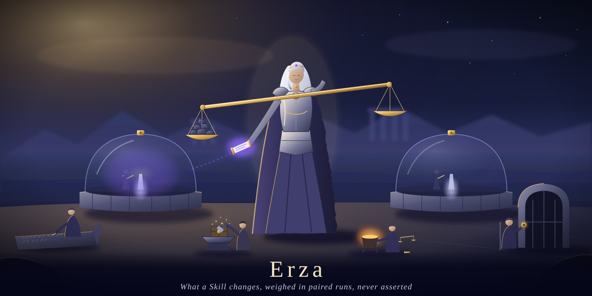

<p align="center"></p>

# Erza SkillsBench: samples

<p align="center"><b>Five sample tasks from Erza SkillsBench, a Harbor benchmark that measures whether curated Agent Skills improve an autonomous agent.</b></p>

<p align="center"><a href="#summary"></a> <a href="#summary"></a> <a href="#rollouts"></a></p>

<p align="center"><sub><a href="#abstract">Abstract</a> | <a href="#summary">Summary</a> | <a href="#tasks">Tasks</a> | <a href="#rollouts">Rollouts</a> | <a href="#coverage">Coverage</a> | <a href="#dataset-structure">Dataset structure</a> | <a href="#reproduction">Reproduction</a> | <a href="#cite">Cite</a> | <a href="#license">License</a> | <a href="#contact">Contact</a></sub></p>

## Abstract

Erza SkillsBench is a benchmark of agentic tasks in [Harbor](https://github.com/laude-institute/harbor) format, built to measure whether curated Agent Skills improve an autonomous agent. It targets [SkillsBench](https://arxiv.org/abs/2602.12670) (arXiv:2602.12670). Each task ships one or two Skills, `SKILL.md` packages of procedural knowledge, and is run twice under identical conditions: once with its Skills and once without. The paired reward difference shows what the Skills add.

Every task runs in an offline container and carries a reference solution, deterministic tests, an LLM-judged rubric, and a continuous reward from 0 to 1. The full benchmark spans software engineering and other expert domains, including cybersecurity, natural science, mathematics and operations research, finance and economics, industrial and physical systems, office work, and media production.

This repository holds the five-task sample. All five are software engineering tasks: the agent repairs seeded faults in a real upstream open source project against a written specification, and documents the root causes it found. The sample covers Python, Go, C++, and Rust. Task images hold no upstream version history, package caches, or reference copies of the code under repair, and agent web search is disabled, so the upstream code is not the answer.

## Summary

| Property | Value |
| --- | --- |
| Tasks | 5 |
| Domain | Software engineering (specification-driven debugging and repair) |
| Languages | Python, Go, C++, Rust |
| Format | Harbor task, schema 1.4 |
| Platforms | linux/amd64, linux/arm64 |
| Skills per task | 1 or 2 |
| Agent | Codex CLI 0.166.0 with `gpt-6.1-sol` |
| Judge | Claude Fable 5.1 |
| Runs per condition | 1 per task |
| Mean reward, no Skills | 0.5561 |
| Mean reward, with Skills | 0.7654 |
| Mean uplift | +0.2093 |

## Tasks

| Task | Project | Language | Objective | Skills |
| --- | --- | --- | --- | --- |
| [`0ddf264f`](0ddf264f-938b-4b5c-817c-45766d0dcf81/) | Pagecraft 0.2.0 | Python | Repair the Pagecraft static site generator so incremental rebuilds, generated outputs, and the check command agree on the shipped example site, and write a root-cause note. | build-chain-triage |
| [`7b7c2a4e`](7b7c2a4e-6d0f-4d55-9a1e-3f2c8b6e5d41/) | etcd raft (`go.etcd.io/raft/v3`) | Go | Bring the Raft library into conformance with Raft's safety properties under crashes, message loss and reordering, partitions, and asynchronous storage, and write a repair report. | persistence-ordering-audit, raft-safety-simulation |
| [`f9336b92`](f9336b92-872f-4ef0-a6a2-719434aa04a4/) | python-dateutil 4.0.0 | Python | Make recurrence expansion conform to RFC 5545 sections 3.3.5, 3.3.10, and 3.8.5.3 through the public `rrule` API, with a regression test per repaired cause and a root-cause note. | rfc5545-recurrence-derivation |
| [`fdc50914`](fdc50914-fdba-4675-a017-31f808f4cf2a/) | regress 0.12.0 | Rust | Repair the ECMAScript regular-expression engine so class sets, case-insensitive matching, duplicate named groups, backreferences, and quantifier backtracking follow ECMA-262 2025 section 22.2, and write a root-cause note. | backtracking-engine-testing, ecma262-algorithm-reading |
| [`fe87d052`](fe87d052-22ef-4406-a429-b2ad5b747881/) | fast_float 8.3.3 | C++ | Bring the decimal-to-binary parser into conformance with round-to-nearest, ties-to-even and its `from_chars` contract for `float` and `double`, and write a repair report. | correctly-rounded-decimal-parsing |

## Rollouts

Each task was run once without Skills (`no-skill`) and once with its Skills mounted (`with-skill`), under identical conditions, and scored by the task's own verifier. Rollouts are stored in each task's `rollouts/<condition>/<job>/<trial>/`.

| Task | Condition | Skills | Model | Agent | Reward | Cost (USD) | Agent time |
| --- | --- | --- | --- | --- | --- | --- | --- |
| 0ddf264f-938b-4b5c-817c-45766d0dcf81 | no-skill | - | gpt-6.1-sol | codex 0.166.0 | 0.6364 | 0.20 | 3m 27s |
| 0ddf264f-938b-4b5c-817c-45766d0dcf81 | with-skill | build-chain-triage | gpt-6.1-sol | codex 0.166.0 | 0.9752 | 0.22 | 4m 36s |
| 7b7c2a4e-6d0f-4d55-9a1e-3f2c8b6e5d41 | no-skill | - | gpt-6.1-sol | codex 0.166.0 | 0.3143 | 0.48 | 10m 51s |
| 7b7c2a4e-6d0f-4d55-9a1e-3f2c8b6e5d41 | with-skill | persistence-ordering-audit, raft-safety-simulation | gpt-6.1-sol | codex 0.166.0 | 0.6857 | 0.67 | 13m 5s |
| f9336b92-872f-4ef0-a6a2-719434aa04a4 | no-skill | - | gpt-6.1-sol | codex 0.166.0 | 0.5192 | 0.06 | 1m 17s |
| f9336b92-872f-4ef0-a6a2-719434aa04a4 | with-skill | rfc5545-recurrence-derivation | gpt-6.1-sol | codex 0.166.0 | 0.5577 | 0.06 | 1m 20s |
| fdc50914-fdba-4675-a017-31f808f4cf2a | no-skill | - | gpt-6.1-sol | codex 0.166.0 | 0.6316 | 0.28 | 5m 35s |
| fdc50914-fdba-4675-a017-31f808f4cf2a | with-skill | backtracking-engine-testing, ecma262-algorithm-reading | gpt-6.1-sol | codex 0.166.0 | 0.7544 | 0.58 | 10m 6s |
| fe87d052-22ef-4406-a429-b2ad5b747881 | no-skill | - | gpt-6.1-sol | codex 0.166.0 | 0.6788 | 0.17 | 3m 43s |
| fe87d052-22ef-4406-a429-b2ad5b747881 | with-skill | correctly-rounded-decimal-parsing | gpt-6.1-sol | codex 0.166.0 | 0.8540 | 0.22 | 5m 57s |

Paired reward per task:

| Task | no-skill | with-skill | Uplift |
| --- | --- | --- | --- |
| 0ddf264f-938b-4b5c-817c-45766d0dcf81 | 0.6364 | 0.9752 | +0.3388 |
| 7b7c2a4e-6d0f-4d55-9a1e-3f2c8b6e5d41 | 0.3143 | 0.6857 | +0.3714 |
| f9336b92-872f-4ef0-a6a2-719434aa04a4 | 0.5192 | 0.5577 | +0.0385 |
| fdc50914-fdba-4675-a017-31f808f4cf2a | 0.6316 | 0.7544 | +0.1228 |
| fe87d052-22ef-4406-a429-b2ad5b747881 | 0.6788 | 0.8540 | +0.1752 |
| **mean** | **0.5561** | **0.7654** | **+0.2093** |

Each trial folder is Harbor's trial output:

| Path | Contents |
| --- | --- |
| `config.json`, `lock.json` | Trial configuration and resolved run settings |
| `result.json` | Agent, model, token usage, cost, timings, and verifier reward |
| `agent/` | Agent trajectory (`trajectory.json`), session transcript, and setup output |
| `verifier/` | `reward.json`, `reward.txt`, `reward-details.json`, and test output |
| `artifacts/` | Files the agent produced, collected from the paths declared in `task.toml` |

## Coverage

| Keyword | Tasks |
| --- | --- |
| backtracking | 1 |
| build-chain | 1 |
| consensus | 1 |
| cpp | 1 |
| debugging | 5 |
| distributed-systems | 1 |
| ecmascript | 1 |
| fault-tolerance | 1 |
| floating-point | 1 |
| go | 1 |
| icalendar | 1 |
| ieee-754 | 1 |
| number-parsing | 1 |
| python | 2 |
| raft | 1 |
| recurrence | 1 |
| regex | 1 |
| rewardkit | 1 |
| rfc5545 | 1 |
| root-cause-analysis | 1 |
| rust | 1 |
| specification-conformance | 3 |
| static-site-generator | 1 |

## Dataset structure

Each task is one Harbor task in a directory named by its uuid.

| Task | Keywords |
| --- | --- |
| [`0ddf264f-938b-4b5c-817c-45766d0dcf81`](0ddf264f-938b-4b5c-817c-45766d0dcf81/) | build-chain, debugging, python, root-cause-analysis, static-site-generator |
| [`7b7c2a4e-6d0f-4d55-9a1e-3f2c8b6e5d41`](7b7c2a4e-6d0f-4d55-9a1e-3f2c8b6e5d41/) | consensus, debugging, distributed-systems, fault-tolerance, go, raft |
| [`f9336b92-872f-4ef0-a6a2-719434aa04a4`](f9336b92-872f-4ef0-a6a2-719434aa04a4/) | debugging, icalendar, python, recurrence, rewardkit, rfc5545, specification-conformance |
| [`fdc50914-fdba-4675-a017-31f808f4cf2a`](fdc50914-fdba-4675-a017-31f808f4cf2a/) | backtracking, debugging, ecmascript, regex, rust, specification-conformance |
| [`fe87d052-22ef-4406-a429-b2ad5b747881`](fe87d052-22ef-4406-a429-b2ad5b747881/) | cpp, debugging, floating-point, ieee-754, number-parsing, specification-conformance |

```
<uuid>/
├── task.toml         runner manifest
├── instruction.md    objective the agent reads
├── environment/      sandbox image, with the task's Skills in skills/
├── tests/            verifier, hidden from the agent
├── solution/         reference solution
└── rollouts/
    ├── no-skill/     <job>/<trial>/ run without Skills
    └── with-skill/   <job>/<trial>/ run with Skills
```

## Reproduction

Each task directory is a complete Harbor task: `task.toml` is the runner manifest, `instruction.md` the objective, `environment/` the sandbox image with the task's Skills under `environment/skills/`, `tests/` the verifier, and `solution/` the reference solution. The rollouts above were produced with:

```bash
harbor run -a codex -m openai/gpt-6.1-sol
```

Run each task once without Skills and once with the Skills in `environment/skills/` to reproduce the paired comparison. The verifier's LLM-judged rubric uses `ANTHROPIC_API_KEY` (Claude Fable 5.1) or, when only `OPENAI_API_KEY` is set, an OpenAI judge.

## Cite

```bibtex
@misc{erza2026,
  title        = {Erza: A Paired-Evaluation Benchmark for Agent Skill Efficacy},
  author       = {{Ethara.AI}},
  year         = {2026}
}
```

## License

Released under the MIT License. Benchmarks, datasets, and task bundles produced through this project retain their own original licences. Copyright (c) 2026 Green Rider Technology LLP (Ethara AI). All rights reserved.

## Contact

Erza SkillsBench is built by [Ethara.AI](https://github.com/Ethara-Ai).

Copyright (c) 2026 Green Rider Technology LLP (Ethara AI). All rights reserved.
